# JOBSHEET 8 - PERULANGAN 2

**Identitas Mahasiswa:**
* **Nama:** Rediswa Janya Sahastana
* **NIM:** 264107020243
* **Kelas / No. Presensi:** TI-1D/25

---

## 1: TUJUAN PRAKTIKUM

Berikut adalah tujuan pelaksanaan praktikum pada bab ini:

1. Memahami konsep dan alur perulangan bersarang.
2. Mengenal sintaks perulangan bersarang.
3. Mampu menerapkan perulangan bersarang untuk menyelesaikan studi kasus sederhana.

---

## 2: HASIL PERCOBAAN & ANALISIS

### 2.1 Percobaan 1: Review Perulangan FOR

Percobaan ini mengulang penggunaan `for` untuk mengulang pencetakan. Program dasar pada Jobsheet mencetak karakter `*` secara mendatar sebanyak `n` kali. Program `Star25.java` yang dikerjakan merupakan modifikasi untuk mencetak bilangan ganjil positif sampai dengan `n`.

#### 2.1.1 Kode Program Java

Kode dasar percobaan mencetak `*` sebanyak `n` kali. Program berikut menerapkan instruksi dasar dan menolak nilai `n` yang bukan bilangan bulat positif:

```java
import java.util.Scanner;

public class Star25 {
    public static void main(String[] args) {
        Scanner sc = new Scanner(System.in);
        System.out.print("Masukkan nilai n = ");
        int n = sc.nextInt();

        if (n <= 0) {
            System.out.println("Nilai n harus positif.");
        } else {
            for (int i = 1; i <= n; i++) {
                System.out.print("*");
            }
            System.out.println();
        }
        sc.close();
    }
}
```

Kode modifikasi yang dikerjakan pada [Star25.java](./Star25.java) mencetak bilangan ganjil positif sampai `n`:

```java
import java.util.Scanner;

public class Star25 {
    public static void main(String[] args) {
        Scanner sc = new Scanner(System.in);
        System.out.print("Masukkan nilai n = ");
        int n = sc.nextInt();

        if (n <= 0) {
            System.out.println("Nilai n harus positif.");
        } else {
            for (int i = 1; i <= n; i += 2) {
                System.out.print(i + " ");
            }
            System.out.println();
        }
        sc.close();
    }
}
```

#### 2.1.2 Hasil Pengujian

| Input `n` | Output program modifikasi |
| :---: | :--- |
| `3` | `1 3` |
| `5` | `1 3 5` |
| `7` | `1 3 5 7` |

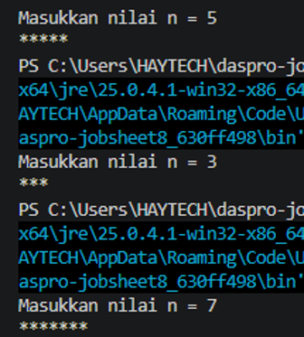

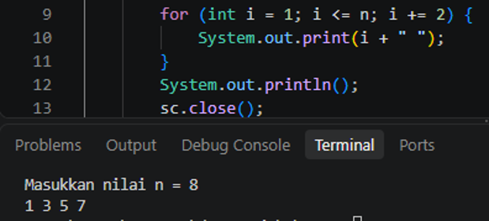

Untuk program dasar, ketika `n = 5`, karakter `*` dicetak sebanyak lima kali dalam satu baris. Modifikasi `Star25.java` menghasilkan bilangan ganjil sampai nilai `n`.

#### 2.1.3 Jawaban Pertanyaan / Pertanyaan Refleksi

* **Pertanyaan 1:** Jika inisialisasi `i = 1` diubah menjadi `i = 0` tanpa mengubah kondisi `i <= n`, berapa karakter `*` yang tercetak ketika `n = 5`? Jelaskan.  
  * **Jawab:** Akan tercetak enam karakter, karena nilai `i` yang memenuhi kondisi adalah `0, 1, 2, 3, 4,` dan `5`.
* **Pertanyaan 2:** Jika kondisi `i <= n` diganti menjadi `i < n`, berapa kali perulangan dijalankan saat `n = 5`? Mengapa hasilnya berbeda?  
  * **Jawab:** Dengan inisialisasi `i = 1`, perulangan berjalan empat kali, yaitu untuk `i = 1, 2, 3,` dan `4`. Operator `<` tidak menyertakan nilai batas `n`, berbeda dengan `<=`.
* **Pertanyaan 3:** Prediksi output potongan kode berikut ketika `n = 9`. Modifikasi kode agar mencetak bilangan ganjil positif yang tidak melebihi `n`.

  ```java
  for (int i = 2; i <= n; i += 2) {
      System.out.print(i + " ");
  }
  ```

  * **Jawab:** Potongan kode tersebut mencetak `2 4 6 8`. Untuk mencetak bilangan ganjil positif sampai `n`, ubah inisialisasi menjadi `i = 1`, seperti pada kode `Star25.java`. Untuk `n = 9`, hasilnya `1 3 5 7 9`.
* **Pertanyaan 4:** Mengapa perubahan increment `i++` menjadi `i--` dengan kondisi tetap `i <= n` membuat perulangan berjalan terus-menerus untuk `n` positif?  
  * **Jawab:** Nilai `i` terus berkurang dan semakin kecil, sehingga tetap memenuhi kondisi `i <= n`. Akibatnya perulangan tidak mencapai kondisi berhenti dan menjadi *infinite loop*. Versi tersebut tidak dijalankan.

---

### 2.2 Percobaan 2: Pola Bintang Persegi Panjang (Nested FOR)

Percobaan ini menerapkan dua perulangan `for`. Perulangan luar mengatur jumlah baris, sedangkan perulangan dalam mengatur karakter pada setiap baris. Program [Rectangle25.java](./Rectangle25.java) menggunakan karakter `#` sesuai modifikasi pada Jobsheet.

#### 2.2.1 Kode Program Java

```java
import java.util.Scanner;

public class Rectangle25 {
    public static void main(String[] args) {
        Scanner sc = new Scanner(System.in);
        System.out.print("Masukkan jumlah baris: ");
        int baris = sc.nextInt();
        System.out.print("Masukkan jumlah kolom: ");
        int kolom = sc.nextInt();
        
        if (baris <= 0 || kolom <= 0) {
            System.out.println("Jumlah baris dan kolom harus lebih dari 0.");
        } else {
            for (int i = 1; i <= baris; i++) {
                for (int j = 1; j <= kolom; j++) {
                    System.out.print("#");
                }
                System.out.println();
            }
        }
        sc.close();
    }
}
```

#### 2.2.2 Hasil Pengujian dan Analisis

Perulangan luar menggunakan `baris` untuk menentukan jumlah baris, sedangkan perulangan dalam menggunakan `kolom` untuk menentukan jumlah karakter pada setiap baris. Jumlah baris dan kolom harus bilangan bulat positif.

| Input `(baris, kolom)` | Bentuk output |
| :---: | :--- |
| `(3, 6)` | 3 baris, masing-masing berisi `######` |
| `(4, 2)` | 4 baris, masing-masing berisi `##` |
| `(1, 5)` | 1 baris berisi `#####` |

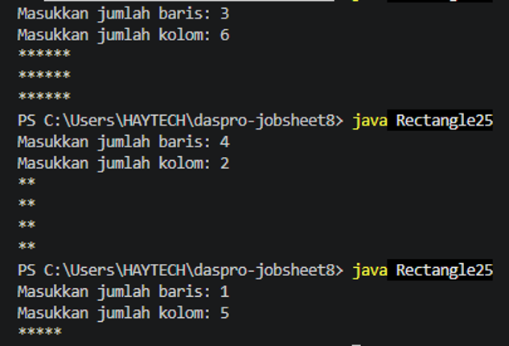

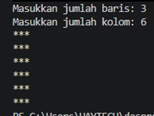

#### 2.2.3 Jawaban Pertanyaan / Pertanyaan Refleksi

* **Pertanyaan 1:** Tentukan fungsi variabel `i` dan `j` pada program tersebut.  
  * **Jawab:** `i` adalah pencacah *outer loop* yang mengatur jumlah baris, sedangkan `j` adalah pencacah *inner loop* yang mengatur jumlah karakter `#` pada setiap baris.
* **Pertanyaan 2:** Berapa kali *outer loop*, *inner loop*, dan `print("#")` dijalankan untuk `baris = 4` dan `kolom = 7`?  
  * **Jawab:** *Outer loop* berjalan 4 kali. *Inner loop* berjalan 7 kali untuk setiap iterasi luar, sehingga keseluruhan badan *inner loop* dan `print("#")` dijalankan `4 × 7 = 28` kali.
* **Pertanyaan 3:** Apa yang terjadi jika batas perulangan luar dan dalam ditukar?  
  * **Jawab:** Outer loop akan mengatur jumlah kolom dan inner loop mengatur jumlah baris. Dengan `baris = 3` dan `kolom = 6`, jika batas loop ditukar, hasilnya 6 baris dengan 3 karakter per baris, bukan 3 baris dengan 6 karakter.
* **Pertanyaan 4:** Jelaskan akibat penghapusan `System.out.println();` setelah *inner loop*.  
  * **Jawab:** Keluaran dari seluruh iterasi akan tersambung pada satu baris, karena tidak ada perintah untuk memindahkan kursor ke baris berikutnya.
* **Pertanyaan 5:** Modifikasi program agar karakter yang dicetak adalah `#`, lalu commit dan push perubahan ke GitHub.  
  * **Jawab:** Karakter pada perintah `System.out.print()` diganti menjadi `#`, seperti pada program `Rectangle25.java`.

---

### 2.3 Percobaan 3: Debugging Bintang Segitiga (Nested WHILE)

Percobaan ini memperbaiki program segitiga dengan perulangan `while` bersarang. Kesalahan pada kode awal adalah indeks baris dimulai dari 0, tidak ada perintah pindah baris setelah pencetakan bintang, dan kondisi outer loop menyebabkan satu iterasi tambahan.

#### 2.3.1 Kode Program Java

Kode hasil perbaikan dan modifikasi untuk mencetak segitiga normal serta terbalik dari [Triangle25.java](./Triangle25.java):

```java
import java.util.Scanner;

public class Triangle25 {
    public static void main(String[] args) {
        Scanner sc = new Scanner(System.in);
        System.out.print("Masukkan nilai n = ");
        int n = sc.nextInt();

        if (n <= 0) {
            System.out.println("Nilai n harus positif.");
        } else {
            // Segitiga Siku-Siku Normal
            int i = 1;
            while (i <= n) {
                int j = 0;
                while (j < i) {
                    System.out.print("*");
                    j++;
                }
                System.out.println();
                i++;
            }

            System.out.println();

            // Segitiga terbalik
            i = n;
            while (i >= 1) {
                int j = 0;
                while (j < i) {
                    System.out.print("*");
                    j++;
                }
                System.out.println();
                i--;
            }
        }

        sc.close();
    }
}
```

#### 2.3.2 Hasil Pengujian dan Analisis

Pada kode awal, `i` dimulai dari 0 dan kondisi `i <= n` membuat *outer loop* berjalan `n + 1` kali. Saat `i = 0`, *inner loop* tidak mencetak bintang. Selain itu, tidak adanya `System.out.println()` setelah *inner loop* menyebabkan keluaran menyambung pada satu baris.

Perbaikan dilakukan dengan memulai `i` dari 1, menambahkan `System.out.println()` setelah *inner loop*, dan tetap mengulang selama `i <= n`. Untuk segitiga terbalik, `i` dimulai lagi dari `n`, kondisi menjadi `i >= 1`, dan nilai `i` dikurangi dengan `i--`.

Dengan input `n = 5`, bagian pertama menghasilkan lima baris dari satu sampai lima bintang; bagian kedua menghasilkan lima baris dari lima sampai satu bintang.

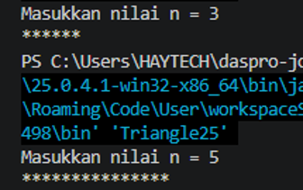

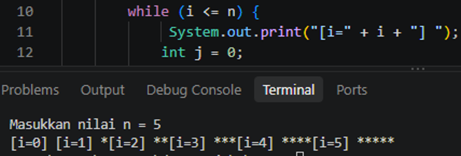

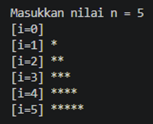

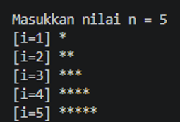

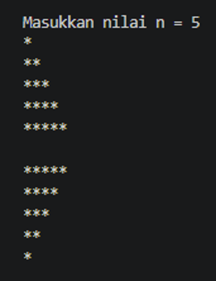

#### 2.3.3 Jawaban Pertanyaan / Pertanyaan Refleksi

* **Pertanyaan 1:** Sebutkan ketidaksesuaian output awal dan minimal dua perbaikan yang diperlukan untuk menghasilkan pola segitiga bertingkat.  
  * **Jawab:** Output awal memiliki baris pertama kosong, seluruh keluaran menyambung dalam satu baris, dan jumlah iterasi outer loop menjadi `n + 1`. Perbaikannya adalah memulai `i` dari 1 agar jumlah baris tepat `n`, serta menambahkan `System.out.println()` setelah *inner loop* agar setiap baris berpindah ke baris baru.
* **Pertanyaan 2:** Jelaskan peran variabel `i` dan `j`. Mengapa `j` harus diinisialisasi kembali ke 0 pada setiap iterasi outer loop? Apa yang terjadi jika `j` tidak di-reset?  
  * **Jawab:** `i` mengatur nomor baris dan jumlah iterasi *outer loop*. `j` menghitung bintang pada setiap baris. `j` harus diinisialisasi ulang agar pencacahan bintang dimulai dari awal untuk setiap baris. Jika tidak di-reset, nilai `j` dari baris sebelumnya terbawa sehingga kondisi `j < i` dapat langsung salah dan bintang pada baris berikutnya tidak tercetak sesuai pola.
* **Pertanyaan 3:** Jelaskan perubahan inisialisasi, kondisi, dan update pada outer loop untuk membentuk segitiga terbalik.  
  * **Jawab:** Inisialisasi diubah menjadi `i = n`, kondisi menjadi `i >= 1`, dan update menjadi `i--`. Dengan demikian, jumlah bintang dimulai dari `n` lalu berkurang satu pada setiap baris hingga satu.

---

### 2.4 Percobaan 4: Studi Kasus Nilai Tugas Proyek Kelompok

Program menerima jumlah kelompok dan jumlah penilai, lalu menghitung rata-rata nilai setiap kelompok. Program menggunakan `while` untuk kelompok, `for` untuk penilai, dan `do-while` untuk mengulang input nilai yang berada di luar rentang 0 sampai 100.

#### 2.4.1 Kode Program Java

Kode program dari [NilaiKelompok25.java](./NilaiKelompok25.java):

```java
import java.util.Scanner;

public class NilaiKelompok25 {
    public static void main(String[] args) {
        Scanner sc = new Scanner(System.in);
        System.out.print("Masukkan jumlah kelompok: ");
        int jumlahKelompok = sc.nextInt();
        System.out.print("Masukkan jumlah penilai : ");
        int jumlahPenilai = sc.nextInt();
        
        if (jumlahKelompok <= 0 || jumlahPenilai <= 0) {
            System.out.println("Jumlah kelompok dan penilai harus > 0.");
        } else {
            int nomorKelompok = 1;
            double rataTertinggi = -1;
            int kelompokTerbaik = 0;
            
            while (nomorKelompok <= jumlahKelompok) {
                System.out.println("Kelompok " + nomorKelompok);
                double totalNilai = 0;
                
                for (int j = 1; j <= jumlahPenilai; j++) {
                    int nilai;
                    do {
                        System.out.print("  Nilai dari Penilai " + j + ": ");
                        nilai = sc.nextInt();
                        if (nilai < 0 || nilai > 100) {
                            System.out.println("  Nilai harus 0-100. Ulangi input!");
                        }
                    } while (nilai < 0 || nilai > 100);
                    totalNilai += nilai;
                }
                
                double rataNilai = totalNilai / jumlahPenilai;
                System.out.println("Kelompok " + nomorKelompok + ": nilai rata-rata = " + rataNilai);
                
                if (rataNilai > rataTertinggi) {
                    rataTertinggi = rataNilai;
                    kelompokTerbaik = nomorKelompok;
                }
                
                nomorKelompok++;
            }
            
            System.out.println("==============================");
            System.out.println("Kelompok terbaik    : " + kelompokTerbaik);
            System.out.println("Rata-rata tertinggi : " + rataTertinggi);
        }
        sc.close();
    }
}
```

#### 2.4.2 Hasil Pengujian dan Analisis

Untuk 3 kelompok dengan 2 penilai, *inner loop* `for` dijalankan 6 kali apabila semua nilai valid. Jika nilai di luar rentang 0–100 dimasukkan, `do-while` meminta masukan ulang untuk penilai yang sama. Nilai `totalNilai` di-reset untuk setiap kelompok, sedangkan `rataTertinggi` tetap dipertahankan sebagai rekor sepanjang pemrosesan.

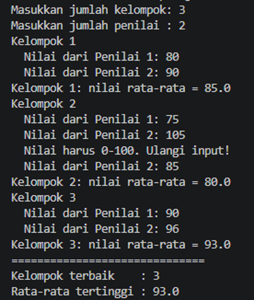

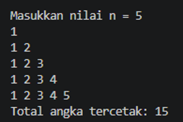

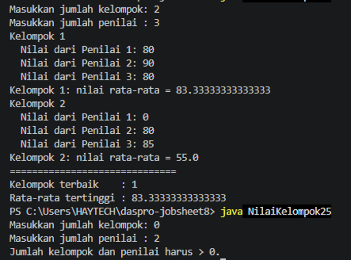

#### 2.4.3 Jawaban Pertanyaan / Pertanyaan Refleksi

* **Pertanyaan 1:** Mengapa `totalNilai` perlu di-reset di dalam outer loop, tetapi `rataTertinggi` tidak boleh di-reset pada setiap kelompok?  
  * **Jawab:** `totalNilai` hanya digunakan untuk menjumlahkan nilai dalam satu kelompok, sehingga harus kembali menjadi 0 saat kelompok berikutnya mulai diproses. `rataTertinggi` menyimpan rekor nilai dari semua kelompok, sehingga harus tetap dipertahankan untuk dibandingkan dengan rata-rata kelompok berikutnya.
* **Pertanyaan 2:** Untuk 3 kelompok dan 2 penilai tanpa input yang salah, berapa kali badan perulangan `for` dijalankan?  
  * **Jawab:** Sebanyak `3 × 2 = 6` kali.
* **Pertanyaan 3:** Apa yang terjadi jika `totalNilai` bertipe `int` dan rata-rata dihitung dengan pembagian dua bilangan bulat? Berikan contoh nilai.  
  * **Jawab:** Hasil pecahan akan terpotong. Contohnya, `171 / 2` dengan pembagian bilangan bulat menghasilkan `85`, bukan `85.5`. Pada program ini `totalNilai` bertipe `double`, sehingga hasil rata-rata dapat menyimpan bagian desimal.
* **Pertanyaan 4:** Mengapa `rataTertinggi` diberi nilai awal `-1`, bukan `0`? Berikan contoh input yang membuat hasil salah apabila nilai awalnya 0.  
  * **Jawab:** Nilai rata-rata yang valid berada pada rentang 0–100, sehingga `-1` memastikan rata-rata kelompok pertama selalu lebih besar dan tercatat. Jika nilai awalnya 0 dan pembaruan menggunakan `>`, seluruh kelompok yang memiliki rata-rata 0 tidak akan memperbarui `kelompokTerbaik`.
* **Pertanyaan 5:** Program ini memiliki tiga tingkat perulangan. Sebutkan masing-masing jenis perulangan beserta perannya.  
  * **Jawab:** `while` luar memproses kelompok; `for` memproses nilai dari setiap penilai; dan `do-while` mengulang pembacaan nilai sampai input berada pada rentang 0–100.

---

## 3: TUGAS MANDIRI

Berikut adalah tugas yang dikerjakan pada Jobsheet ini:

- [x] **Tugas 1:** Mencetak pola bilangan bertingkat dan menghitung total angka yang dicetak.
- [x] **Tugas 2:** Membuat tabel perkalian `n × n` dan menghitung jumlah seluruh hasil perkalian.
- [x] **Tugas 3:** Merekap jumlah pelanggan dan barang pada beberapa toko serta menentukan toko dengan barang terbanyak.

### 3.1 Tugas 1: Pola Bilangan Bertingkat

Program mencetak bilangan dari 1 sampai dengan nomor baris. Variabel `totalAngka` menghitung banyaknya bilangan yang dicetak.

#### Kode Program Java

```java
import java.util.Scanner;

public class Tugas1_25 {
    public static void main(String[] args) {
        Scanner sc = new Scanner(System.in);
        System.out.print("Masukkan nilai n = ");
        int n = sc.nextInt();
        
        if (n < 1) {
            System.out.println("Nilai n minimal 1.");
        } else {
            int totalAngka = 0;

            for (int i = 1; i <= n; i++) {
                for (int j = 1; j <= i; j++) {
                    System.out.print(j + " ");
                    totalAngka++;
                }
                System.out.println();
            }
            System.out.println("Total angka tercetak: " + totalAngka);
        }
        sc.close();
    }
}
```

Untuk `n = 5`, pola yang dihasilkan memiliki 15 angka, yaitu `1 + 2 + 3 + 4 + 5`.

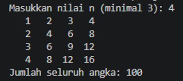

### 3.2 Tugas 2: Tabel Perkalian

Program menggunakan nested `for` untuk mencetak tabel perkalian dan menjumlahkan seluruh hasil perkalian. Program meminta `n` minimal 3.

#### Kode Program Java

```java
import java.util.Scanner;

public class Tugas2_25 {
    public static void main(String[] args) {
        Scanner sc = new Scanner(System.in);
        System.out.print("Masukkan nilai n (minimal 3): ");
        int n = sc.nextInt();
        
        if (n < 3) {
            System.out.println("Nilai n minimal harus 3.");
        } else {
            int jumlahSeluruhAngka = 0;
            
            for (int i = 1; i <= n; i++) {
                for (int j = 1; j <= n; j++) {
                    int hasil = i * j;
                    System.out.printf("%4d", hasil);
                    jumlahSeluruhAngka += hasil;
                }
                System.out.println();
            }
            System.out.println("Jumlah seluruh angka: " + jumlahSeluruhAngka);
        }
        sc.close();
    }
}
```

Untuk `n = 4`, tabel berisi hasil perkalian dari `1 × 1` sampai `4 × 4`, dan jumlah seluruh angkanya adalah 100.

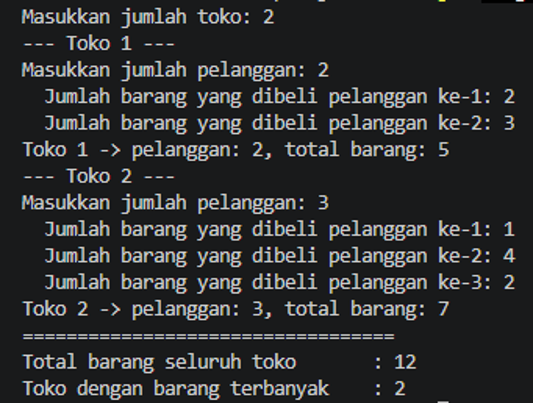

### 3.3 Tugas 3: Rekap Penjualan Beberapa Toko

Program menerima jumlah toko, jumlah pelanggan pada setiap toko, serta jumlah barang yang dibeli setiap pelanggan. Program menghitung total barang per toko dan keseluruhan, kemudian menentukan toko dengan total barang terbanyak. Apabila ada nilai tertinggi yang sama, penggunaan operator `>` mempertahankan toko bernomor paling kecil yang ditemukan lebih dahulu.

#### Kode Program Java

```java
import java.util.Scanner;

public class Tugas3_25 {
    public static void main(String[] args) {
        Scanner sc = new Scanner(System.in);
        System.out.print("Masukkan jumlah toko: ");
        int jumlahToko = sc.nextInt();
        
        if (jumlahToko <= 0) {
            System.out.println("Jumlah toko minimal 1.");
        } else {
            int totalBarangSeluruhToko = 0;
            int maxBarang = -1;
            int tokoTerbaik = 1;
            
            for (int i = 1; i <= jumlahToko; i++) {
                System.out.println("--- Toko " + i + " ---");
                System.out.print("Masukkan jumlah pelanggan: ");
                int jumlahPelanggan = sc.nextInt();

                while (jumlahPelanggan < 0) {
                    System.out.println("Jumlah pelanggan tidak boleh negatif.");
                    System.out.print("Masukkan jumlah pelanggan: ");
                    jumlahPelanggan = sc.nextInt();
                }

                int totalBarangToko = 0;
                
                for (int p = 1; p <= jumlahPelanggan; p++) {
                    System.out.print("  Jumlah barang yang dibeli pelanggan ke-" + p + ": ");
                    int barangPelanggan = sc.nextInt();

                    while (barangPelanggan < 0) {
                        System.out.println("Jumlah barang tidak boleh negatif.");
                        System.out.print("  Jumlah barang yang dibeli pelanggan ke-" + p + ": ");
                        barangPelanggan = sc.nextInt();
                    }

                    totalBarangToko += barangPelanggan;
                }
                
                System.out.println("Toko " + i + " -> pelanggan: " + jumlahPelanggan + ", total barang: " + totalBarangToko);
                
                totalBarangSeluruhToko += totalBarangToko;
                
                if (totalBarangToko > maxBarang) {
                    maxBarang = totalBarangToko;
                    tokoTerbaik = i;
                }
            }
            
            System.out.println("==================================");
            System.out.println("Total barang seluruh toko       : " + totalBarangSeluruhToko);
            System.out.println("Toko dengan barang terbanyak    : " + tokoTerbaik);
        }
        sc.close();
    }
}
```

Contoh pada Jobsheet menghasilkan total barang 5 untuk Toko 1 dan 7 untuk Toko 2, dengan total keseluruhan 12 dan Toko 2 sebagai toko dengan barang terbanyak. Program juga meminta ulang jika jumlah pelanggan atau jumlah barang yang dimasukkan negatif.


---

## 4: KESIMPULAN

Melalui praktikum ini, perulangan bersarang digunakan untuk menyusun keluaran berbentuk baris dan kolom, membentuk pola segitiga, dan memproses data bertingkat. Perulangan luar mengatur unit utama yang diproses, sementara perulangan dalam menyelesaikan pekerjaan berulang untuk setiap unit tersebut. Inisialisasi, kondisi, pembaruan pencacah, dan penempatan perintah pindah baris menentukan apakah pola dan jumlah iterasi sesuai dengan kebutuhan.
